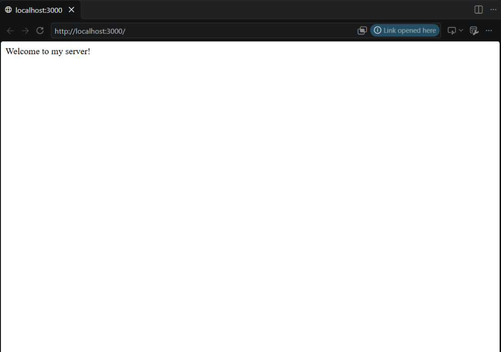
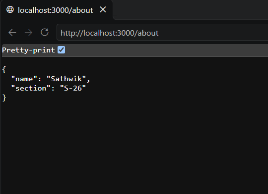
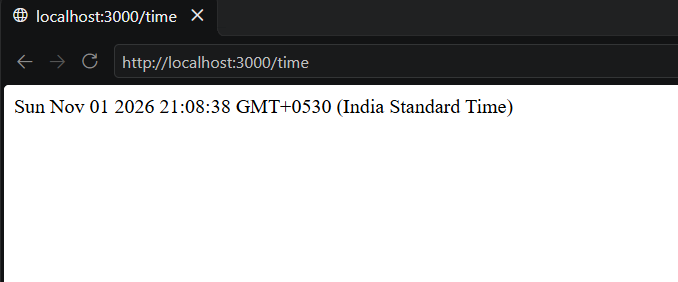
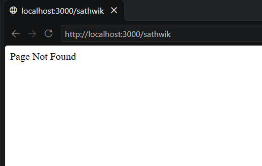

# Lab 1: Node.js and Express Server

**Subject:** Backend Development Fundamentals  
**Year/Term:** Year II, Term II  
**University:** Aurora Deemed to be University  
**Faculty:** Mr. Joel Prashanth D

## Student Details

| Field               | Details           |
| ------------------- | ----------------- |
| Name                | Bandaru Sathwik |
| Registration Number | 252U1R9126        |
| Section             | S-26              |
| Class               | 112               |
## Project Objective

This lab demonstrates the fundamentals of creating and running a Node.js backend server with Express.js. It covers project initialization with npm, dependency installation, Express application setup, route handling, JSON responses, date and time generation, HTTP status codes, and handling unknown routes.

The current implementation uses Express.js in `server.js`. It listens on the port provided by the hosting platform, or port `3000` when run locally.

## Technologies Used

- Node.js
- Express.js `^5.3.0`
- npm
- JavaScript (CommonJS)
- HTTP and JSON response handling

## Project Folder Structure

```text
lab-01/
├── server.js
├── package.json
├── package-lock.json
├── README.md
├── .gitignore                 # Recommended; do not commit dependencies or secrets
└── screenshot/
    ├── home.png
    ├── about.png
    ├── time.png
    └── not-found.png
```

## Installation and Execution

### Prerequisites

- Node.js and npm installed on the computer

### Install dependencies

1. Open a terminal in the project directory.
2. Initialize a project if starting from an empty folder:

   ```bash
   npm init -y
   ```

3. Install Express:

   ```bash
   npm install express
   ```

   For an existing checkout, `npm install` installs the dependencies recorded in `package-lock.json`:

   ```bash
   npm install
   ```

### Start the server

Start the server with:

```bash
npm start
```

The server listens on:

```text
http://localhost:3000
```

Stop the server with `Ctrl+C`.

## Endpoints

| HTTP Method | Path             | Description                                                                                 | Expected Status Code |
| ----------- | ---------------- | ------------------------------------------------------------------------------------------- | -------------------: |
| GET         | `/`              | Returns `Welcome to my server!`                                                             |                  200 |
| GET         | `/about`         | Returns JSON containing the name `Sathwik` and section `S-26`                               |                  200 |
| GET         | `/time`          | Returns the current date and time generated with `new Date()`                               |                  200 |
| Any         | Any unknown path | Returns `Page Not Found` through the 404 middleware                                         |                  404 |

Example requests:

```text
http://localhost:3000/
http://localhost:3000/about
http://localhost:3000/time
http://localhost:3000/unknown
```

## Screenshots

### Home Route



### About Route



### Time Route



### 404 Route



## Deploy to Render

Create a **Web Service** in Render and connect this GitHub repository with the following settings:

| Setting | Value |
| --- | --- |
| Root Directory | `lab-01` |
| Build Command | `npm install` |
| Start Command | `npm start` |

Render provides the port through the `PORT` environment variable. The server uses it automatically. After deployment, open the service URL to check the home route; `/about` and `/time` are also available.

## Problems Faced and Solutions

| Problem                                          | Solution                                                                                                                   |
| ------------------------------------------------ | -------------------------------------------------------------------------------------------------------------------------- |
| Understanding how npm manages a Node.js project  | Used `npm init -y` to create `package.json` and reviewed the project metadata and scripts.                                 |
| Express was not available by default             | Installed Express with `npm install express`, which also updated `package.json`, `package-lock.json`, and `node_modules/`. |
| Different routes need different response formats | Used `res.send()` for text responses and `res.json()` for the `/about` response.                                           |
| Unknown URLs should return an error response     | Added a final Express middleware that sends a 404 response for unmatched paths.                                            |

## Learning Outcomes

- Created a Node.js project with npm.
- Understood the purpose of `package.json`, `package-lock.json`, and `node_modules/`.
- Installed and used Express.js.
- Created an Express application that listens on the platform-provided port or port 3000 locally.
- Implemented GET routes and returned text and JSON responses.
- Generated the current date and time using `new Date()`.
- Applied HTTP status codes for successful and unknown requests.
- Practiced documenting and preparing a backend project for deployment.

## Git Hygiene

The following files and directories must not be committed to GitHub:

```gitignore
node_modules/
.env
```

Create a `.gitignore` file in the project root containing these entries before committing the project. Never commit credentials, API keys, or other environment-specific secrets.